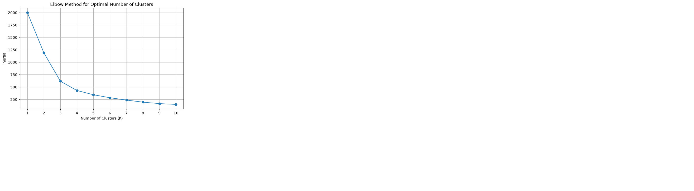
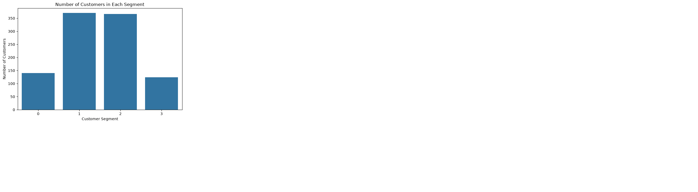
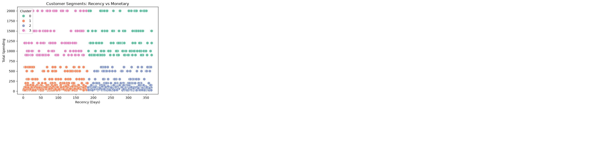

# Customer Segmentation Analysis

## Project Overview
This project focuses on segmenting customers based on their purchasing behavior using the RFM (Recency, Frequency, Monetary) analysis method and K-Means clustering.

## Objective
- Analyze customer purchasing behavior.
- Calculate Recency, Frequency, and Monetary values.
- Group customers into meaningful segments using K-Means.
- Visualize customer segments and provide marketing recommendations.

## Tools and Technologies
- Python
- Pandas
- NumPy
- Matplotlib
- Seaborn
- Scikit-learn
- Jupyter Notebook

## Project Workflow
1. Load and inspect the retail sales dataset.
2. Check missing values and prepare the data.
3. Calculate RFM metrics for each customer.
4. Standardize the RFM features using StandardScaler.
5. Use the Elbow Method to examine the number of clusters.
6. Apply K-Means clustering.
7. Analyze and visualize customer segments.
8. Develop segment-based marketing recommendations.


## Visualizations

### 1. Elbow Method Plot


### 2. Customer Count by Cluster


### 3. Recency vs. Monetary Scatter Plot

### 3. Recency vs. Monetary Scatter Plot


## Key Learning Outcomes
- Customer behavior analysis using RFM.
- Data preprocessing and feature standardization.
- K-Means clustering with scikit-learn.
- Data visualization and interpretation.
- Data-driven marketing recommendations.

## How to Run
1. Install the required libraries:
   ```bash
   python -m pip install pandas numpy matplotlib seaborn scikit-learn jupyter
   ```
2. Open `customer_segmentation_analysis.ipynb` in Jupyter Notebook or VS Code.
3. Update the dataset file path if needed.
4. Run the notebook cells in order.

## Dataset
The project uses a retail sales dataset containing customer IDs, transaction dates, and
